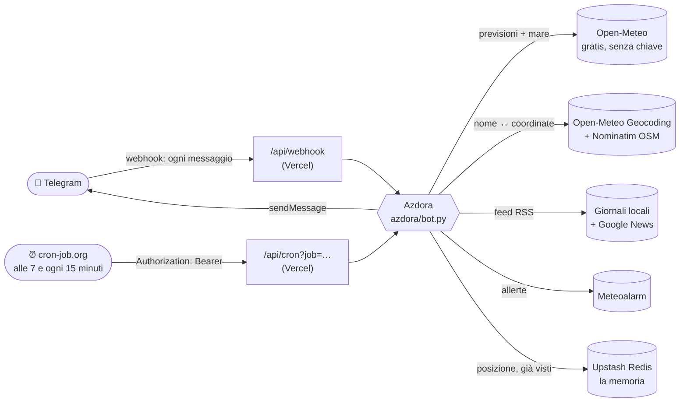

# 🏖️ Azdora

[](https://github.com/amazzotti/azdora-bot/actions/workflows/ci.yml)


[](LICENSE)

**Bot Telegram personale che ti segue ovunque: meteo, vento, mare, notizie e allerte del posto in cui ti trovi, più scadenze, spese e una lista condivisa.**

In Romagna l'*azdora* è chi manda avanti la casa: sa che tempo fa, si ricorda le scadenze e dice a tutti cosa c'è da fare. Questo bot fa lo stesso, su Telegram.

- 📍 **Dove sei tu.** Mandagli la posizione, anche quella in tempo reale. Meteo, vento, mare, notizie e allerte riguardano il comune e la regione in cui ti trovi: Misano, Bologna, la montagna o una gita all'estero.
- 🔎 **Dove vuoi tu.** `/meteo cesenatico`, `/vento san marino`, `/notizie bologna`: qualsiasi comune, cercato per nome.
- 👨‍👩‍👧 **Per tutta la famiglia.** Babbo, fidanzata e chi vuoi possono avere la loro chat privata con il bot, ognuno con i suoi dati e il suo riepilogo delle 7.
- 🏠 **Casa in Riviera.** Se non sa dove sei, usa casa: Riccione e Rimini, con i giornali locali e i venti dell'Adriatico chiamati per nome.

> 🇬🇧 English summary at the [bottom of the page](#-english-summary).

---

## ✨ Cosa sa fare

### 💬 Scrivigli come parli
Non serve ricordarsi i comandi:

| Scrivi… | …e l'Azdora |
|---|---|
| `45 benzina` · `ho speso 12,50 per la pizza` · `pagato 80€ di bolletta luce` | segna la spesa, indovina la categoria e mostra i pulsanti **🏷️ Cambia categoria** e **↩️ Annulla**. Se correggi una categoria, la volta dopo la sceglie da sola |
| `ricordami domani alle 18 di chiamare il meccanico` · `ricordami tra 2 ore…` · `ricordami venerdì…` | crea un promemoria e te lo manda all'ora giusta, con i pulsanti **⏰ +1 ora**, **📅 Domani** e **✅ Fatto** |
| `ricordami ogni lunedì alle 20 di portare fuori la plastica` · `ogni sera…` · `ogni mese il 5…` · `ogni anno il 14/2…` | promemoria **ricorrenti** |
| `ricordami il compleanno della mamma il 14/3` · `compleanno di Giulia 2 maggio 1995` | **compleanni**: avviso una settimana prima (per il regalo), il giorno prima e il giorno stesso, ogni anno; con l'anno di nascita dice quanti anni compie |
| `ricordami di comprare il pane quando arrivo a Rimini` · `quando torno a casa ricordami di…` · `…quando arrivo al lavoro` | promemoria **legati a un posto**: scatta quando ci arrivi (paesi, casa o posti salvati con `/posto`) |
| 📍 la tua posizione | ti dà meteo, vento, mare e consigli di quel punto, e da lì in poi segue te |

Nei gruppi, dove la gente chiacchiera, capisce solo le frasi che iniziano con `spesa` (o `+`) e `ricordami`: `spesa 60 conad`, `+12 pizza`.

### 📋 Tutti i comandi

| Comando | Cosa risponde |
|---|---|
| `/oggi` | Riepilogo di oggi: meteo, vento, mare, alba e tramonto, consigli pratici. Mostra casa (Riccione e Rimini) e, se sei lontano, prima il posto in cui ti trovi |
| `/domani` | Lo stesso, per domani |
| `/meteo [località]` | Condizioni attuali e previsioni dei prossimi giorni **dove sei**, oppure in **qualsiasi comune** scritto (`/meteo cesenatico`) |
| `/vento [località]` | Vento adesso, ogni 3 ore e giorno per giorno, con i nomi dei venti dell'Adriatico (**garbino**, bora, scirocco, maestrale…), nodi e scala Beaufort |
| `/mare [località]` | Altezza, direzione e periodo delle onde, stato del mare (scala Douglas), temperatura dell'acqua, su qualsiasi costa. Nell'entroterra ti dice che il mare è lontano |
| `/qui` | Mostra il pulsante **📍 Manda la mia posizione** |
| 📍 *posizione* | Se mandi la tua posizione (anche con 📎 → Posizione, anche **in tempo reale**), ti risponde con meteo, vento, mare e consigli **per il punto in cui sei**, e per 3 giorni notizie e allerte seguono te |
| `/notizie [località]` | Le **notizie di oggi divise per città** (📍 la tua per prima, poi Cervia, Cesenatico, Cesena, Bellaria, Rimini, Santarcangelo, Riccione, Misano, Cattolica, Pesaro), e in fondo le principali dall'**Italia** e dal **mondo**. Con una località (`/notizie cesenatico`), o fuori zona, solo quel comune. Sempre con il link all'articolo |
| `/italia` · `/mondo` | Le principali notizie italiane e dal mondo, in ordine di importanza (Google News, con RaiNews e ANSA di riserva) |
| `/allerte` | Allerte meteo (gialla, arancione, rossa) della regione in cui ti trovi, in Italia e in diversi paesi europei |
| `/dove` · `/dimentica` | Dove il bot crede che tu sia · cancella la posizione salvata |
| `/scadenza 31/01 bollo auto 180€ annuale` | Segna una scadenza: data, cosa, importo e ricorrenza (mensile, bimestrale, annuale…) in qualsiasi ordine |
| `/scadenze` | Tutte le scadenze, con i pulsanti **✅ Pagato** e **🗑**. Se paghi una scadenza ricorrente, si sposta alla volta dopo e l'importo finisce tra le spese |
| `/spesa 45 benzina` | Segna una spesa; la categoria (🚗 Auto, 🛒 Spesa, 💡 Bollette, 🍕 Fuori…) la indovina il bot |
| `/mese [mese]` · `/spese` · `/annulla` | Riepilogo del mese per categoria con il confronto col mese prima · ultime spese · togli l'ultima |
| `/esporta [anno]` | Il file CSV delle spese dell'anno, pronto per Excel |
| `/aggiungi latte, pane` · `/lista` · `/svuota` | La lista condivisa: si spunta toccando le voci. Nel gruppo di coppia mostra chi ha aggiunto cosa |
| `/lista fissa` · `/lista sgancia` | **Fissa la lista in alto nella chat**: si aggiorna da sola quando qualcuno aggiunge o spunta qualcosa, e in chat arriva solo una conferma corta. Nei gruppi serve il permesso di fissare i messaggi (o la fissi tu a mano: si aggiorna lo stesso) |
| `/weekend` | Meteo di sabato e domenica, tre idee per un giro (al coperto se piove) e le sagre ed eventi della settimana |
| `/sagre` | **Sagre, fiere e feste da Cervia a Pesaro**: il calendario delle feste di sempre del prossimo mese (Fiera dei Becchi a Santarcangelo, Il Pesce fa Festa a Cesenatico, Sapore di Sale a Cervia, Tartufo a Sant'Agata, Presepe della Marineria…) e quelle trovate nei giornali delle ultime due settimane |
| `/costa` · `/costa domani` | **Tutta la costa in un messaggio**: Cervia e Milano Marittima, Cesenatico, Bellaria, Rimini, Riccione, Cattolica e Gabicce, Pesaro, con tempo, vento e mare |
| `/orari` | **Quando ti scrivo**: `/orari mattino 6:30`, `/orari sera 21`, `/orari notizie 8 13 19` (riassunti) o `/orari notizie subito`, `/orari silenzio 23-7`, `/orari avvisi off`. Ognuno della famiglia ha i suoi |
| `/telefono` | Ti dà una chiave personale per far mandare la **posizione in automatico** dal telefono (Comandi Rapidi su iPhone, HTTP Shortcuts o Tasker su Android), con le istruzioni passo passo. `/telefono off` la disattiva |
| `/budget 800` · `/budget auto 150` | Budget mensile, totale o per categoria. Sotto ogni spesa vedi a che punto sei, con ⚠️ all'80% e 🚨 quando lo superi |
| `/conti` · `/pareggio` | **Nel gruppo**: ogni spesa ricorda chi l'ha pagata. `/conti` dice chi deve quanto a chi (spese divise in parti uguali, con il minor numero di passaggi); `/pareggio` riparte da zero |
| `/promemoria` · `/ricordami …` | I promemoria in arrivo (anche quelli legati a un posto), con 🗑 per cancellarli |
| `/tv` · `/tv film` · `/tv adesso` · `/tv domani` · `/tv rai1` · `/tv sky` | **Guida TV**: la prima serata di stasera sui canali del digitale terrestre (dalla 1 alla 66, in ordine di telecomando), solo i film con la trama, cosa c'è adesso e dopo, la giornata di un canale, gli stessi per Sky. La guida si aggiorna da sola due volte al giorno da fonti XMLTV gratuite (con fonti di riserva) e resta salvata per i giorni dopo: se le fonti si fermano, `/tv` continua a funzionare. `/stato` dice quando è stata aggiornata |
| `/compleanni` · `/compleanno Giulia 2/5/1995` | I compleanni segnati, dal più vicino, con 🗑 per toglierli. Nel gruppo valgono per il gruppo (e lì si segnano solo con «ricordami…» o con il comando, così le chiacchiere non diventano compleanni) |
| `/posto lavoro` · `/posto` · `/posto lavoro off` | Salva dove sei adesso con un nome (casa, lavoro, mamma, palestra…), per i promemoria «quando arrivo al lavoro». Il promemoria scatta quando *entri* nel posto: se ci sei già, aspetta che esci e rientri. Serve la posizione automatica (`/telefono`, anche con l'automazione *Arrivo* di Comandi Rapidi) o quella in tempo reale |
| `/rifiuti martedì plastica, carta` | Il calendario della raccolta differenziata: la sera prima, verso le 20, ti dice cosa portare fuori |
| `/sera` | Attiva o spegne il **riepilogo delle 20**: meteo di domani, promemoria e scadenze del giorno dopo |
| `/aria [località]` | Indice UV con consiglio, qualità dell'aria e pollini (graminacee, betulla, olivo, ambrosia…). Nel riepilogo compaiono solo quando servono |
| `/benzina [gasolio\|gpl\|metano] [località]` | I 5 distributori più economici entro 7 km, con prezzo, self/servito, distanza e link alla mappa, dai dati ufficiali del Ministero |
| `/stato` | Come sta il bot: versione, memoria, messaggi bloccati, **ultimo giro della sveglia** e se il **menu dei comandi** è aggiornato (se non lo è, lo sistema subito) |
| `/id` | L'id della chat, da usare nella configurazione |
| `/aiuto` | L'elenco dei comandi |

**Senza località, i comandi usano il posto in cui sei**: l'ultima posizione che hai mandato negli ultimi 3 giorni. Se non sa dove sei, usa casa (Riccione). Nel gruppo di coppia vale la posizione del gruppo o, se manca, la tua.

In più, da sola, **agli orari che scegli con `/orari`**:
- **ogni mattina** (di default alle 7) l'Azdora manda il riepilogo della giornata, con in fondo i **promemoria di oggi** e le **prime notizie**. Se sei lontano da casa, aggiunge il meteo di dove sei; se ci sono allerte, le mette in fondo. Poi arrivano i **promemoria delle scadenze**: 30, 7 e 1 giorno prima, il giorno stesso, e se sono scadute e non pagate. Il **1° del mese** arriva anche il **resoconto delle spese** del mese prima;
- **ogni 15 minuti** consegna i **promemoria** arrivati all'ora giusta, controlla le **allerte** della tua regione e ti avvisa se **sta per piovere**, se mentre piove sta per arrivare un **acquazzone**, se arriva un **temporale** (dicendo se c'è **grandine**), la **neve** o **raffiche** sopra i 60 km/h nelle prossime 2 ore, dove sei tu (previsioni a 15 minuti di Open-Meteo, lo stesso avviso al massimo ogni 4 ore);
- **le notizie** arrivano in un **riassunto completo** diviso per città (fino a 10, la tua per prima, più le principali di Italia e mondo) **ogni ora, dalle 8 alle 22**, solo se c'è qualcosa di nuovo. Puoi scegliere orari tuoi (`/orari notizie 8 13 19`) o riceverle una per volta appena escono (`/orari notizie subito`). Non ti manda mai due volte la stessa cosa;
- nelle **ore di silenzio** (di default 23–7) niente notizie né avvisi: passano solo i promemoria e le allerte arancioni e rosse;
- **la sera** (di default alle 20) ti ricorda i **rifiuti** da portare fuori e, se hai attivato `/sera`, ti manda il riepilogo di domani.

**Anche nei gruppi, senza doppioni.** Notizie, avvisi di pioggia e allerte possono arrivare anche nel gruppo di coppia o in quello col babbo: di partenza sono spenti, così non ricevi tre notifiche uguali. Nel gruppo scrivi `/orari notizie ogni ora`, `/orari avvisi on` o `/orari allerte on`: sotto la risposta c'è il pulsante «🔕 Allora non mandarmele in privato», che le spegne nella tua chat privata, così arrivano una volta sola, nel gruppo. Nel gruppo valgono per la posizione condivisa lì o, se manca, per la tua.

**Messaggi lunghi e menu sempre aggiornati.** Telegram accetta al massimo 4096 caratteri per messaggio: se un riepilogo è più lungo, l'Azdora lo divide a fine riga in più messaggi, senza mai spezzare un link. Se Telegram rifiutasse la formattazione, lo rimanda come testo semplice: meglio brutto che niente. Quando escono comandi nuovi, il menu `/` di Telegram si aggiorna da solo al giro successivo della sveglia (per le chat private, i gruppi e Telegram in italiano), e ogni 6 ore il bot ricontrolla che sia ancora giusto.

**Se qualcosa va storto non si perde niente**: un promemoria che Telegram non ha accettato si riprova al giro dopo; se alle 7 il meteo non risponde, il riepilogo si riprova ogni 15 minuti invece di arrivare vuoto; un giornale con un feed difettoso viene saltato senza fermare gli altri; un controllo che si rompe non blocca i successivi; e se un comando incontra un errore imprevisto, l'Azdora risponde comunque invece di restare muta.

**Chi decide quando arrivano?** La sveglia di cron-job.org chiama il bot ogni 15 minuti. A ogni giro il bot guarda gli orari di ognuno e manda solo quello che è arrivato il momento di mandare, una volta sola. Il cronjob delle 7 (`job=mattino`) può restare: rispetta comunque gli orari di `/orari`.

Ecco un riepilogo vero:

```text
☀️ Buongiorno Ale!
Oggi è giovedì 5 novembre.

📍 Riccione
🌦️ Rovesci deboli · 10°/15° · pioggia 28% (0.2 mm)
💨 Adesso: Maestrale da NO ↘ 10 km/h (5 nodi), raffiche 21 km/h · forza 2, brezza leggera
🌬️ In giornata: Maestrale da NO ↘, fino a 10 km/h, raffiche 21 km/h
🌊 Mare: onde fino a 0.4 m da NE (poco mosso) · acqua 17°C

📍 Rimini
...

🌅 Alba 06:50 · 🌇 Tramonto 16:54 · UV max 2

Consigli
🌂 Possibile qualche goccia (28%): ombrello in macchina.
```

I consigli vengono da regole semplici e leggibili (soglie in [`azdora/riepilogo.py`](azdora/riepilogo.py)). Il bot avvisa di ombrello, temporali, nebbia in A14, raffiche forti, gelo, caldo, UV alto, mare mosso e… *giornata da spiaggia*.

## 🧭 Come funziona



1. **Scrivi un comando** al bot. Telegram lo inoltra subito al **webhook** su Vercel. La funzione [`api/webhook.py`](api/webhook.py) controlla l'header segreto che Telegram rimanda a ogni chiamata e passa il messaggio al bot.
2. **Il bot** ([`azdora/bot.py`](azdora/bot.py)) controlla che la chat sia autorizzata, capisce il comando e scarica i dati da **Open-Meteo**: previsioni dall'API *forecast*, onde e temperatura dell'acqua dall'API *marine*.
3. **I numeri diventano parole**: i gradi diventano punti cardinali e nomi dei venti ([`vento.py`](azdora/meteo/vento.py)), le altezze d'onda diventano lo stato del mare ([`mare.py`](azdora/meteo/mare.py)) e i codici WMO diventano emoji ([`codici_wmo.py`](azdora/meteo/codici_wmo.py)). Il messaggio è composto in HTML di Telegram ([`messaggi.py`](azdora/messaggi.py)).
4. **Posizione e località.** Se mandi la posizione, il bot cerca il nome del comune su Nominatim di OpenStreetMap ("Misano Adriatico (RN)") e calcola il meteo per quel punto esatto. Per `/meteo cesenatico` usa invece la ricerca per nome di Open-Meteo. Il mare compare solo se il punto marino di Open-Meteo ha dati ed è entro 30 km ([`luoghi.py`](azdora/luoghi.py)).
5. **La memoria.** Su Vercel ogni richiesta parte da zero. Per questo la posizione e l'elenco di cosa è già stato mandato stanno su **Upstash Redis**, che si usa via HTTP senza driver ([`archivio.py`](azdora/archivio.py)). La "zona" è l'ultima posizione degli ultimi 3 giorni, altrimenti Riccione ([`posizione.py`](azdora/posizione.py)).
6. **Notizie** ([`notizie.py`](azdora/notizie.py)), da Cervia a Pesaro:
   - **Cervia, Milano Marittima e Cesenatico**: il Resto del Carlino Ravenna, Ravenna Today e Ravenna Notizie (solo le notizie che nominano il litorale), più una ricerca su Google News dedicata, che porta anche La Voce di Cesenatico e Living Cesenatico;
   - **Cesena**: il Resto del Carlino Cesena, Cesena Notizie, Cesena Today, Romagna Notizie;
   - **Rimini**: Rimini Today, Altarimini, Chiamami Città, il Resto del Carlino Rimini, NewsRimini;
   - **Pesaro**: il Resto del Carlino Pesaro, Pesaro Notizie, Corriere Adriatico Pesaro.

   Fuori zona c'è una ricerca su Google News che funziona ovunque: tiene solo gli articoli che nominano il posto nel titolo, o che arrivano da un giornale con quel nome. Vengono scartati le pagine elenco ("Ultim'ora…"), gli aggregatori spazzatura e i doppioni, anche quando i titoli differiscono solo per un apostrofo. Si capiscono i soprannomi (`/notizie mima`). Se di una frazione non si parla (Milano Marittima, Viserba, Pinarella…), il bot passa alle notizie del suo comune. I giornali che rifiutano i programmi automatici sul loro feed (Rimini Today, Cesena Today, NewsRimini) vengono letti da Google News, che li pubblica con il link originale. Il bot si presenta sempre con il suo nome, senza fingersi un browser. L'XML si legge con `defusedxml`; doppioni, notizie vecchie e siti di scommesse vengono scartati.
7. **Allerte** ([`allerte.py`](azdora/allerte.py)): l'API pubblica di **Meteoalarm**, per regione, dal livello giallo in su. In Emilia-Romagna il bot aggiunge il link ad Allerta Meteo Emilia-Romagna, che pubblica le allerte ufficiali.
8. **Scadenze, spese e lista** ([`scadenze.py`](azdora/scadenze.py), [`spese.py`](azdora/spese.py), [`lista.py`](azdora/lista.py)): si scrivono come si parla. Il parser capisce date (`31/01`, `domani`), importi (`12,50€`, `1.234`) e ricorrenze in qualsiasi ordine ([`soldi.py`](azdora/soldi.py)). Gli importi sono tenuti in centesimi interi. Ogni chat ha i suoi dati, quindi il gruppo di coppia ha spese e lista di casa separate da quelle personali. I pulsanti sotto i messaggi aggiornano il messaggio stesso, senza riempire la chat.
9. **Weekend** ([`weekend.py`](azdora/weekend.py)): un piccolo catalogo di gite a meno di un'ora da Riccione. Se il weekend è brutto propone quelle al coperto, e ogni settimana ne sceglie di diverse. Sagre ed eventi arrivano dagli articoli "Eventi" di Altarimini e da Google News, filtrati sulla Romagna.
10. **Frasi libere** ([`linguaggio.py`](azdora/linguaggio.py), [`promemoria.py`](azdora/promemoria.py)): regole scritte a mano, niente intelligenza artificiale, quindi gratis, istantanee e prevedibili. Una spesa è una frase con **un solo** importo e qualche parola, così "ci vediamo alle 8 e 30" non diventa una spesa. Per i promemoria vengono capiti "tra N minuti/ore/giorni", "oggi/domani/dopodomani/stasera/domattina", i giorni della settimana, le date e "alle 18.30".
11. **Soldi** ([`budget.py`](azdora/budget.py), [`conti.py`](azdora/conti.py)): budget per categoria con soglie, e conti di gruppo calcolati sui saldi di ognuno con un algoritmo che riduce al minimo i passaggi di soldi. I centesimi avanzati vengono distribuiti in modo che i conti tornino sempre a zero.
12. **Aria e carburante** ([`meteo/aria.py`](azdora/meteo/aria.py), [`carburante.py`](azdora/carburante.py)): l'API della qualità dell'aria di Open-Meteo (dati CAMS) e i due file aperti che il Ministero pubblica ogni mattina, cioè l'elenco dei distributori con le coordinate e i prezzi.
13. **cron-job.org** chiama [`api/cron.py`](api/cron.py) con un secondo segreto: alle 7 con `job=mattino` (il riepilogo), ogni 15 minuti con `job=controlli` (promemoria, allerte, notizie e, alle 20, rifiuti e sera).

### Scelte di progetto

- **Niente framework per bot.** La Bot API viene chiamata direttamente con `httpx` ([`telegram.py`](azdora/telegram.py)): le dipendenze sono 2 e il codice gira uguale su Vercel, su GitHub Actions e in locale.
- **Logica separata dall'infrastruttura.** `bot.py` non sa nulla di HTTP. Riceve dall'esterno *chi spedisce i messaggi* e *da dove arriva il meteo*, quindi nei test si usano dei finti e nel simulatore la console.
- **Costo zero:**

  | Pezzo | Servizio | Piano |
  |---|---|---|
  | Comandi (webhook) | Vercel | Hobby, gratuito |
  | Orari | cron-job.org | gratuito |
  | Meteo e mare | Open-Meteo | gratuito per uso non commerciale, senza chiave |
  | Memoria | Upstash Redis | free tier (500.000 comandi al mese), senza carta |
  | Notizie e allerte | feed RSS, Google News, Meteoalarm | pubblici |
  | CI | GitHub Actions | gratuito |

## 🔒 Privacy e sicurezza

- **Nessun segreto nel codice.** Token e chiavi vivono solo nelle variabili d'ambiente di Vercel e nei GitHub Secrets. Il file `.env` è escluso da git.
- **Webhook protetto**: le richieste senza l'header `X-Telegram-Bot-Api-Secret-Token` giusto ricevono `401`. Il confronto è a tempo costante.
- **Cron protetto**: serve `Authorization: Bearer <CRON_SECRET>`.
- **Il bot risponde solo alle chat che autorizzi tu**: la tua chat privata, quelle dei familiari, il gruppo di coppia e gli altri gruppi che indichi. Agli sconosciuti dice solo il loro `/id`. Solo tu puoi aggiungerlo a un gruppo: se lo fa un altro, il bot esce da solo.
- **Ogni chat ha i suoi dati.** Scadenze, spese, lista e posizione di una persona non si mescolano con quelle delle altre. Il database Upstash però è tuo: avvisa i familiari che tecnicamente potresti vederli.
- **Scadenze, spese e lista** stanno solo nel tuo database Upstash, mai nel repository.
- **Posizione**: la salva solo se gliela mandi tu, nel tuo database Upstash, e la cancella da sola dopo 30 giorni (per notizie e allerte conta solo quella degli ultimi 3). Con `/dimentica` la cancelli subito. Le coordinate vanno a Open-Meteo e Nominatim solo per chiedere meteo e nome del luogo.
- **Nei log non finisce il token**: gli errori di rete vengono riformulati senza l'URL, che lo contiene.

## 🚀 Messa in funzione

Bastano una ventina di minuti, una volta sola.

### 1. Crea il bot su Telegram
1. Scrivi a [@BotFather](https://t.me/BotFather) e manda `/newbot`.
2. Come nome scegli `Azdora`, come username ad esempio `azdora_riccione_bot`.
3. Copia il **token**. ⚠️ È una password: non va mai nel codice. Se ti scappa, rigeneralo con `/revoke`.

### 2. Genera due segreti casuali
```bash
py -c "import secrets; print(secrets.token_urlsafe(32))"
```
Lancialo due volte: un segreto serve per `TELEGRAM_WEBHOOK_SECRET`, l'altro per `CRON_SECRET`.

### 3. Pubblica su Vercel
1. Su [vercel.com](https://vercel.com) entra con GitHub (piano **Hobby**) e scegli **Add New → Project → `azdora-bot`**.
2. Lascia **Framework Preset: Other**.
3. In **Environment Variables** aggiungi:

   | Variabile | Valore |
   |---|---|
   | `TELEGRAM_BOT_TOKEN` | il token di BotFather |
   | `TELEGRAM_BOT_USERNAME` | lo username del bot, senza `@` |
   | `TELEGRAM_WEBHOOK_SECRET` | il primo segreto |
   | `CRON_SECRET` | il secondo segreto |
   | `AZDORA_NOME` | come vuoi essere salutato, es. `Ale` |
   | `UPSTASH_REDIS_REST_URL` | dal punto 6 (si possono aggiungere anche dopo) |
   | `UPSTASH_REDIS_REST_TOKEN` | dal punto 6 |
   | `TELEGRAM_CHAT_ID_FAMIGLIA` | facoltativa: id dei familiari separati da virgola (punto 7) |
   | `TELEGRAM_CHAT_ID_COPPIA` | facoltativa: id del gruppo di coppia (punto 8) |
   | `TELEGRAM_CHAT_ID_GRUPPI` | facoltativa: id di altri gruppi, es. con il babbo, separati da virgola (punto 8) |

4. Clicca **Deploy**. Per controllare, apri `https://<progetto>.vercel.app/api/webhook`: deve rispondere `{"ok": true, ...}`.

### 4. Collega Telegram a Vercel
1. Su GitHub vai in **Settings → Secrets and variables → Actions** e aggiungi i secret `TELEGRAM_BOT_TOKEN` e `TELEGRAM_WEBHOOK_SECRET`.
2. In **Actions → Configura bot → Run workflow** inserisci l'indirizzo Vercel.
3. Scrivi `/id` al bot e lui ti risponde con il tuo id.
4. Aggiungi `TELEGRAM_CHAT_ID` con quel numero su Vercel; poi in **Deployments** scegli **Redeploy**, perché le variabili nuove valgono solo dal deploy successivo.
5. Aggiungi lo stesso `TELEGRAM_CHAT_ID` anche nei GitHub Secrets.
6. Prova `/oggi`. 🎉

### 5. Riepilogo delle 7 con cron-job.org
1. Crea un account gratuito su [cron-job.org](https://cron-job.org) e imposta il fuso **Europe/Rome**.
2. Scegli **Create cronjob**:
   - **URL**: `https://<progetto>.vercel.app/api/cron?job=mattino`
   - **Orario**: ogni giorno alle 07:00
   - **Advanced → Headers**: `Authorization` = `Bearer <CRON_SECRET>`
3. Lancia **Test run** e il riepilogo ti arriva su Telegram.

Per provare il riepilogo senza cron-job.org c'è anche il workflow **Actions → Prova riepilogo**.

### 6. Memoria, notizie e allerte (Upstash + un secondo cron)
1. Su [upstash.com](https://upstash.com) entra con GitHub, scegli **Create Database → Redis**, regione **eu-central-1 (Frankfurt)** e piano **Free**. Non serve la carta.
2. Nella pagina del database, sezione **REST API**, copia `UPSTASH_REDIS_REST_URL` e `UPSTASH_REDIS_REST_TOKEN` nelle Environment Variables di Vercel, poi fai **Redeploy**.
   - In alternativa puoi usare l'integrazione **Upstash** dal Marketplace di Vercel: crea le variabili `KV_REST_API_URL` e `KV_REST_API_TOKEN`, che il bot riconosce lo stesso.
3. Su cron-job.org crea un secondo cronjob:
   - **URL**: `https://<progetto>.vercel.app/api/cron?job=controlli`
   - **Orario**: ogni 15 minuti
   - **Header**: lo stesso `Authorization` di prima.
4. Mandagli la posizione e prova `/notizie` e `/allerte`.

Senza Upstash meteo, notizie e weekend funzionano lo stesso. Scadenze, spese e lista invece hanno bisogno della memoria, e i controlli automatici non mandano nulla per non ripeterti ogni volta le stesse notizie.

### 7. La famiglia (facoltativo)
Per dare il bot a tuo babbo, alla tua ragazza o a chi vuoi, ognuno nella sua chat privata:
1. Ognuno apre il bot su Telegram (ad esempio `t.me/azdora_riccione_bot`), preme **Avvia** e scrive `/id`. Il bot gli risponde con un numero.
2. Su Vercel metti tutti quei numeri, separati da virgola, in `TELEGRAM_CHAT_ID_FAMIGLIA` (ad esempio `123456789,987654321`) e fai **Redeploy**.
3. Fatto: ognuno ha le sue scadenze, spese, lista e posizione, e riceve il suo riepilogo delle 7 con il suo nome e il meteo, le notizie e le allerte di dove si trova. Il meteo si scarica una volta sola per tutti, quindi i costi restano a zero.

### 8. Il gruppo di coppia (facoltativo)
1. Crea un gruppo Telegram con la tua ragazza e aggiungi il bot: siccome lo aggiungi tu, resta e ti scrive l'id del gruppo (un numero negativo).
2. Metti quel numero in `TELEGRAM_CHAT_ID_COPPIA` su Vercel e fai **Redeploy**.
3. Su @BotFather manda `/setjoingroups`, scegli il bot e poi **Disable**: nessun altro potrà più aggiungerlo a un gruppo.
4. Nel gruppo funzionano tutti i comandi: lista condivisa, spese di casa, scadenze comuni, weekend.

Altri gruppi, ad esempio uno con tuo babbo, si aggiungono allo stesso modo. Il loro id (sempre negativo) va in `TELEGRAM_CHAT_ID_GRUPPI`, separati da virgola, poi si fa **Redeploy**. Ogni gruppo ha la sua lista, le sue spese e le sue scadenze. Fai `/setjoingroups → Disable` solo dopo aver aggiunto il bot a tutti i gruppi che ti servono: se poi ne serve un altro, rimetti **Enable**, aggiungilo e torna su **Disable**.

## 🛠️ Sviluppo in locale

```bash
py -3.12 -m venv .venv
.venv\Scripts\activate          # su Linux/macOS: source .venv/bin/activate
pip install -e ".[dev]"
```

```bash
pytest --cov       # test, con copertura
ruff check .       # lint
ruff format .      # formattazione
```

### Simulatore
Puoi provare il bot dal terminale **senza Telegram e senza token**, con il meteo vero:

```bash
python -m azdora.simula /oggi "/vento rimini" "/meteo cesenatico" /mare
python -m azdora.simula posizione:43.978,12.697   # come se mandassi la posizione
python -m azdora.simula /notizie /allerte    # notizie e allerte della zona
python -m azdora.simula posizione:44.49,11.34 controlli   # i controlli ogni 15 minuti
python -m azdora.simula "/scadenza 7/11 bollo 180€ annuale" /scadenze tocca:pagato:1
python -m azdora.simula "/spesa 45 benzina" /mese "/aggiungi latte, pane" tocca:voce:1 /weekend
python -m azdora.simula mattino              # il messaggio delle 7
python -m azdora.simula --offline /domani    # con i dati salvati, senza internet
```

### Struttura

```text
azdora-bot/
├─ api/                    # funzioni serverless di Vercel
│  ├─ webhook.py           #   POST /api/webhook  ← Telegram
│  ├─ cron.py              #   GET  /api/cron     ← cron-job.org
│  └─ posizione.py         #   POST /api/posizione ← il tuo telefono
├─ azdora/
│  ├─ bot.py               # comandi, permessi, riepiloghi
│  ├─ messaggi.py          # testi in HTML di Telegram
│  ├─ riepilogo.py         # riepilogo giornaliero e consigli
│  ├─ telegram.py          # client minimale della Bot API
│  ├─ web.py               # logica degli endpoint (segreti, JSON, errori)
│  ├─ vercel.py            # adattatore HTTP per Vercel
│  ├─ config.py            # località e variabili d'ambiente
│  ├─ luoghi.py            # nome ↔ coordinate, distanze
│  ├─ posizione.py         # posizione salvata e zona attuale
│  ├─ archivio.py          # memoria: Upstash Redis (o in memoria per i test)
│  ├─ notizie.py           # feed RSS e Google News, filtri e doppioni
│  ├─ allerte.py           # allerte Meteoalarm per regione
│  ├─ scadenze.py          # scadenze, ricorrenze e promemoria
│  ├─ spese.py             # spese, categorie, resoconto, CSV
│  ├─ soldi.py             # importi in centesimi, date e mesi all'italiana
│  ├─ lista.py             # lista condivisa con le spunte
│  ├─ weekend.py           # meteo del weekend, gite e sagre
│  ├─ linguaggio.py        # spese scritte come si parla
│  ├─ promemoria.py        # "ricordami domani alle 18 di…"
│  ├─ budget.py            # budget mensile e avvisi
│  ├─ conti.py             # spese divise nel gruppo
│  ├─ rifiuti.py           # raccolta differenziata
│  ├─ feste.py             # feste fisse della zona e /sagre
│  ├─ costa.py             # /costa: da Cervia a Pesaro
│  ├─ orari.py             # /orari: mattino, sera, notizie, silenzio
│  ├─ telefono.py          # posizione automatica dal telefono
│  ├─ carburante.py        # distributori più economici (open data MIMIT)
│  ├─ app.py               # monta i pezzi reali
│  ├─ simula.py            # simulatore da terminale
│  ├─ configura.py         # imposta webhook e menu comandi
│  ├─ lavori.py            # lavori da riga di comando (es. mattino)
│  └─ meteo/
│     ├─ openmeteo.py      # client e modello dati di Open-Meteo
│     ├─ vento.py          # rosa dei venti, nodi, Beaufort
│     ├─ mare.py           # scala Douglas
│     ├─ aria.py           # UV, qualità dell'aria, pollini
│     ├─ imminente.py      # "sta per piovere": avvisi a 15 minuti
│     └─ codici_wmo.py     # codici meteo → testo ed emoji
├─ tests/                  # pytest + respx, con risposte vere (meteo, feed, allerte) in fixtures/
└─ .github/workflows/      # CI, "Configura bot", "Prova riepilogo"
```

## 🗺️ Roadmap

- [x] **Tappa 1: meteo, vento e mare.** Comandi, riepilogo delle 7, test, CI.
- [x] **Meteo dove sei.** Posizione condivisa, `/qui`, qualsiasi comune per nome.
- [x] **Tappa 2: notizie e allerte intorno a me.** Posizione ricordata (anche in tempo reale), notizie nuove con link, allerte Meteoalarm, riepilogo che segue la posizione.
- [x] **Tappa 3: scadenze.** Bollo, assicurazione, revisione, bollette, con promemoria a 30, 7, 1 e 0 giorni e il pulsante "✅ Pagato".
- [x] **Tappa 4: spese mensili.** `/spesa 45 benzina`, riepilogo per categoria, resoconto il 1° del mese, esportazione in CSV.
- [x] **Tappa 5: chat di coppia.** Lista condivisa con le spunte, idee per il weekend: giri della domenica, sagre ed eventi in Romagna, con il meteo.
- [x] **Più utile**: spese e promemoria scritti come si parla, categorie che imparano, budget, conti di coppia, raccolta differenziata, riepilogo della sera, UV e pollini, carburante più economico. Idee prese da bot open source come [MyDollarBot](https://github.com/mtkumar123/MyDollarBot), [SmartSpend2](https://github.com/CSC510-G35-Fall2022/SmartSpend2) e [Spliit](https://github.com/spliit-app/spliit), riscritte da zero.
- [x] **Su misura**: orari personali e ore di silenzio, riassunti delle notizie, avvisi "sta per piovere", posizione automatica dal telefono, promemoria ricorrenti con rimanda.
- [ ] **Prossime idee**: treni Riccione–Bologna, grafico delle spese, foto dello scontrino.

## 🙏 Fonti dei dati

- Meteo, mare e ricerca delle località: [Open-Meteo.com](https://open-meteo.com/), licenza [CC BY 4.0](https://creativecommons.org/licenses/by/4.0/).
- Notizie: feed RSS pubblici dei giornali citati e Google News; i titoli rimandano sempre all'articolo originale.
- Carburanti: open data del [Ministero delle Imprese e del Made in Italy](https://www.mimit.gov.it/it/open-data/elenco-dataset/carburanti-prezzi-praticati-e-anagrafica-degli-impianti), licenza IODL 2.0.
- UV, qualità dell'aria e pollini: [Open-Meteo Air Quality](https://open-meteo.com/en/docs/air-quality-api) (dati Copernicus CAMS).
- Allerte: [Meteoalarm](https://meteoalarm.org), licenza CC BY 4.0 (per l'Italia, dati del Servizio Meteorologico dell'Aeronautica Militare). Non sostituiscono le allerte ufficiali della [Protezione Civile](https://www.protezionecivile.gov.it) e di [Allerta Meteo Emilia-Romagna](https://allertameteo.regione.emilia-romagna.it/).
- Nome del luogo dalla posizione: [Nominatim](https://nominatim.org/), dati © [OpenStreetMap](https://www.openstreetmap.org/copyright) contributors, licenza ODbL.
- I dati del mare si riferiscono a un punto al largo: sono indicativi per la costa.

---

## 🇬🇧 English summary

**Azdora** is a personal Telegram bot that follows you wherever you are. Share your location and weather, wind, sea, local news and weather alerts are about the town and region you're in; ask for any town by name; when it doesn't know where you are, it falls back to home in Riccione and Rimini, on Italy's Adriatic coast. *Azdora* is the Romagna dialect word for the person who runs the household.

- **Features:**
  - current weather and 3-day forecasts;
  - wind with local Adriatic wind names, knots and Beaufort scale;
  - sea state (waves on the Douglas scale, water temperature);
  - a daily 7 AM briefing with practical tips;
  - weather wherever you are: share your Telegram location (live location too), or ask for any town by name;
  - location-aware local news with links (local RSS feeds and Google News) and Meteoalarm weather alerts, pushed every 15 minutes without repeats;
  - bill and car-tax reminders with a "Paid" button (recurring deadlines roll forward and become expenses);
  - monthly expenses with automatic categories, monthly reports and CSV export;
  - a shared checklist for couples that can live pinned at the top of the chat and update itself, and weekend ideas (weather-aware day trips and local festivals);
  - a TV guide (prime time, films, now on air, per-channel) from free XMLTV sources with fallbacks and a multi-day cache;
  - birthday reminders a week before, the day before and on the day, with age;
  - location-based reminders ("remind me to buy bread when I get to Rimini") triggered by the phone's automatic location;
  - plain-language input: "45 fuel" or "remind me tomorrow at 6pm to call the mechanic" (in Italian), with rule-based parsing and no paid AI;
  - categories that learn from your corrections, monthly budgets with alerts, and Splitwise-style balances in group chats;
  - waste-collection and evening reminders, UV/air quality/pollen, and the cheapest fuel nearby from Italian open data.
- **Stack:**
  - Python 3.12 and `httpx`, calling the Telegram Bot API directly (no bot framework);
  - Telegram webhook served by Vercel serverless functions;
  - schedules from cron-job.org;
  - Upstash Redis via its REST API as the bot's memory;
  - data from the free, keyless Open-Meteo API, Nominatim, RSS feeds and Meteoalarm.
- **Zero cost** on free tiers. Secrets live only in environment variables, never in the code.
- **Quality:**
  - business logic is decoupled from infrastructure through small protocols;
  - 650+ pytest tests, using real recorded API responses and respx HTTP mocks, including an end-to-end test of the Vercel handlers;
  - ruff lint and format checks;
  - GitHub Actions CI.
- **Also:** per-person schedules and quiet hours, news digests, 15-minute rain/storm/gust nowcast alerts, automatic location from the phone (iOS Shortcuts / Android), recurring reminders with snooze.
- **Next ideas:** train delays, spending charts, receipt photos.

Licensed under the [MIT License](LICENSE).
